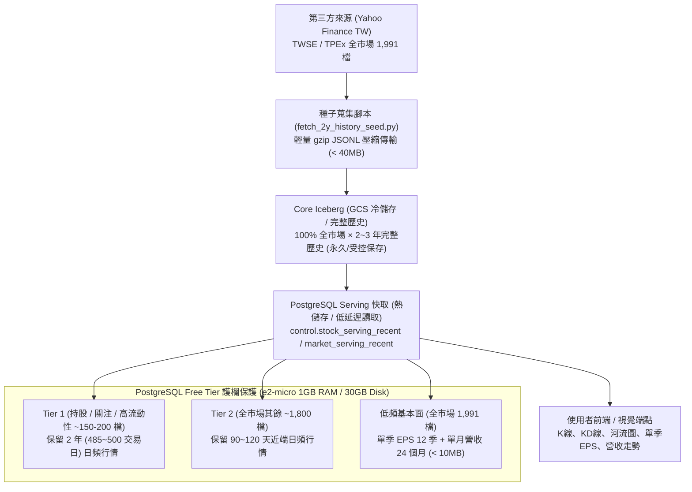
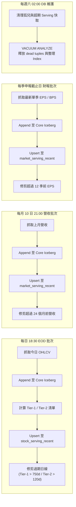

# Janus SPEC — 全市場歷史資料種子收錄與 Serving 快取生命週期契約

> **權威宣告**：本規格為補齊個股歷史資料（2 年日頻 OHLCV、3 年單季 EPS、2 年單月營收、KD 線與河流圖基礎數據）之架構與日常運作契約。依據 [`PROJECT_RULES.md`](../PROJECT_RULES.md) §1.7（第三方公開來源核准）與 §1.3（GCP Free Tier 資源守護），本契約明確劃分 Core Iceberg（全量冷儲存）與 PostgreSQL Serving（有界熱快取）的責任邊界，並制定日常自動滾動與淘汰排程。

---

## 1. 背景與問題定義

1. **現況缺口**：
   - 使用者反映個股圖表缺乏足夠歷史資料，導致 2 年日 K 線圖、KD 指標線、營收趨勢圖、本益比河流圖（Valuation River Chart）多數處於缺失或截斷狀態。
   - 官方交易所（TWSE / TPEx / MOPS）對海外機房 IP 存在嚴格速率限制與定時阻擋（Cloud Run / 外網存取頻繁出現 403 / 429 或 Timeout）。
2. **解決途徑**：
   - 採行「**一次性全市場歷史種子收錄（Seed Collection） $\rightarrow$ 轉入 Core Iceberg $\rightarrow$ 投影至 PostgreSQL Serving 快取 $\rightarrow$ 接入日常批次滾動更新與淘汰**」。
   - 資料來源依 [`PROJECT_RULES.md`](../PROJECT_RULES.md) §1.7 採用已核准之公開第三方來源（Yahoo Finance TW API 及網頁端點），具備零 IP 阻擋、免驗證碼、高可用且數據結構標準之特性。

---

## 2. 雙層儲存架構與資料分流

本系統堅持 **「分析倉（Iceberg）與即時讀取庫（PostgreSQL）分工」** 原則：

### 2.1 儲存層級職責

| 儲存層級 | 載體 | 資料範圍 | 讀取端 | 職責與特性 |
|---|---|---|---|---|
| **Core 湖倉 (Silver)** | GCS Iceberg (Parquet) | 全市場 1,991 檔 $\times$ 完整 2~3 年歷史 | Ingestion Jobs / 特徵工程 / Mart 分析 | 規範化單一事實來源（Single Source of Truth），成本極低，支援批次計算與歷史重播 |
| **Serving 快取 (Projection)** | PostgreSQL `control.*_serving_recent` | 分級有界快取（Tier 1: 2年；Tier 2: 120天；基本面: 12季/24月） | FastAPI Public Runtime / User App | 極低延遲點查（Point Query），支撐 Flutter 圖表與白話資訊，嚴格防止磁碟膨脹 |

---

## 3. GCP Free Tier 護欄與分級容量管理

為嚴格遵守 GCP Free Tier 限制（`e2-micro`，1GB RAM，30GB 永久磁碟），PostgreSQL **絕不無界堆放全市場數百萬筆歷史日線**，一律實施分級淘汰（Cold/Hot Tiering）：

### 3.1 儲存容量試算表

| 資料類別 | 對象與深度 | 預估總筆數 (Rows) | 預估磁碟空間 | 記憶體快取負擔 | 結論 |
|---|---|---|---|---|---|
| **低頻：單季 EPS** | 全市場 1,991 檔 $\times$ 12 季 | ~23,892 筆 | ~3.5 MB | 輕微 (< 5MB) | **全量進 Serving 快取** |
| **低頻：單月營收** | 全市場 1,991 檔 $\times$ 24 個月 | ~47,784 筆 | ~6.0 MB | 輕微 (< 8MB) | **全量進 Serving 快取** |
| **高頻：Tier 1 日線** | 持股 / 關注 / 前 150 檔 $\times$ 2 年 (500日) | ~75,000~100,000 筆 | ~25.0 MB | 中等 (~20MB) | **保留 2 年完整走勢與河流圖** |
| **高頻：Tier 2 日線** | 其餘 ~1,800 檔 $\times$ 90~120 天 | ~160,000~210,000 筆 | ~45.0 MB | 中等 (~30MB) | **保留近端日線供 KD/選股** |
| **合計總量** | **全系統 Serving 快取** | **約 250,000 ~ 380,000 筆** | **約 80 ~ 95 MB** | **小於 70MB** | **安全低於 30GB 限制 (< 0.3%)** |

> [!IMPORTANT]
> - 當任何 Tier 2 股票被使用者加入「關注清單」或「個人持股」時，系統動態將其升格為 **Tier 1**，並自動從 Core Iceberg 補足其 2 年歷史資料至 Serving 快取。
> - 移出關注且不在持股名單滿 30 天後，降格回 Tier 2，於週末例行批次自動修剪至 120 天。

---

## 4. 日常正常運作與滾動淘汰排程（Lifecycle Policy）

資料生命週期不能僅限於「首次種子匯入」，必須在日常運作中全自動維護、滾動更新並修剪過期快照：

### 4.1 批次執行時間點與淘汰規則

1. **每日 EOD 行情批次（交易日 18:30 Asia/Taipei）**：
   - **觸發器**：Cloud Scheduler $\rightarrow$ `janus-ingestion-core`。
   - **動作**：
     1. 收錄當日上市櫃個股收盤價、成交量、高低價。
     2. 寫入 Core Iceberg `warehouse/core/ohlcv`。
     3. 刷新 `control.stock_serving_recent` 投影。
     4. **淘汰修剪（Prune）**：
        - 對屬於 **Tier 1** 的股票：執行 `DELETE FROM control.stock_serving_recent WHERE dataset_id = 'ohlcv' AND symbol = :sym AND sort_at < NOW() - INTERVAL '750 days'`（保留 2 年餘裕）。
        - 對屬於 **Tier 2** 的股票：執行 `DELETE FROM control.stock_serving_recent WHERE dataset_id = 'ohlcv' AND symbol = :sym AND sort_at < NOW() - INTERVAL '120 days'`。
2. **每月營收申報批次（每月 10 日 21:00 Asia/Taipei）**：
   - **觸發器**：Cloud Scheduler 於台灣法規營收公告截止（每月 10 日）後啟動。
   - **動作**：
     1. 收錄全市場上月營業收入、MoM、YoY。
     2. 寫入 Core Iceberg `warehouse/core/financials`。
     3. 投影至 `control.market_serving_recent`。
     4. **淘汰修剪（Prune）**：
        - 執行 `DELETE FROM control.market_serving_recent WHERE dataset_id = 'financials' AND payload_json->>'metric' = 'monthly_revenue' AND sort_at < NOW() - INTERVAL '25 months'`（維持 24 個月滑動窗口）。
3. **每季財報申報批次（每年 3/31、5/15、8/14、11/14 22:00 Asia/Taipei）**：
   - **觸發器**：Cloud Scheduler 於法定財報公告日啟動。
   - **動作**：
     1. 收錄最新單季 EPS 與每股淨值（BPS）。
     2. 寫入 Core Iceberg。
     3. 投影至 `control.market_serving_recent`。
     4. **淘汰修剪（Prune）**：
        - 執行 `DELETE FROM control.market_serving_recent WHERE dataset_id = 'financials' AND payload_json->>'metric' = 'eps_single_quarter' AND sort_at < NOW() - INTERVAL '40 months'`（維持 12 季滑動窗口）。
4. **週末例行維護與空間回收（每週六 02:00 Asia/Taipei）**：
   - **觸發器**：現有 PostgreSQL VM 定時 cron 或 Scheduler 維護任務。
   - **動作**：
     1. 執行孤兒檢查與兜底清理。
     2. 執行 `VACUUM ANALYZE control.stock_serving_recent, control.market_serving_recent;`。
     3. 回收過期索引與 dead tuples 空間，防止 PostgreSQL 磁碟產生碎片膨脹。

---

## 5. 資料傳輸與檔案格式規範

1. **避免 binary dependency 與 exec mount 限制**：
   - 種子檔案採用 Python 內建標準庫 `gzip` 與 `json`，產出 `.jsonl.gz` 壓縮檔。
   - 完全不依賴本機 C 編譯、Rust 編譯或 `noexec` 掛載點問題（如 `pyarrow` 在受限使用者目錄的載入限制）。
   - 全市場 1,991 檔歷史日線（約 96 萬筆）壓縮後總容量小於 **35 MB**，極度輕量便於上傳與搬移。
2. **存放目錄規範**：
   - 本機產出：`data/seed/*.jsonl.gz`
   - GCS 備份與 Stage 匯入：`gs://{PROJECT_ID}-stage/seed_data/`
   - Google Drive 正式留存：`janusChatGPT/seed_data/`
3. **資料表 Schema 對齊**：
   - 日頻行情：`control.stock_serving_recent` (`dataset_id='ohlcv'`)
   - 單季 EPS：`control.market_serving_recent` (`dataset_id='financials'`, `payload_json->>'metric'='eps_single_quarter'`)
   - 單月營收：`control.market_serving_recent` (`dataset_id='financials'`, `payload_json->>'metric'='monthly_revenue'`)
