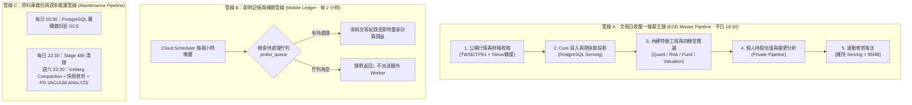

# 統一批次與資料快照契約

更新：2026-10-29。只以新版三大管線與本文件的有界驗收為準；舊批次時段、補跑、需求緩衝與自然等待不再形成工作義務。實際部署／驗收狀態見 [唯一 TODO](../todo.md) 與 [Operations](operations-and-testing.md)。
本文件是批次時段、端到端依賴與備份政策的唯一入口，覆蓋舊每日時段與 GitHub 備份 cron。四個模型按可發布設計；這不是目前 Registry、模型效用或 runtime 已通過的宣告。

## 1. 既有 Controller 直接接續

沿既有 Controller／Worker／PostgreSQL VM，不新增服務、IAM 或付費資源。鏈路有工作時每15秒讀取持久終態，每個 tick 後釋放共用鎖，最長50分鐘，Controller Job timeout 60分鐘；不是長時間 HTTP 或常駐服務。不等下一個兩小時 tick，逾時保留本次狀態、不盲重送。

## 2. 新版唯一入口與執行表

Cloud Scheduler `30 */2 * * *`，`Asia/Taipei`，唯一目標既有 `janus-batch-controller`。不新增 Scheduler／Job／PubSub／Cloud Tasks，GitHub Actions 不執行日常業務 cron。既有 VM 一分鐘 timer 只領取 Controller 已建立的備份／維護 request，不自行建立業務日期工作。

| 管線／實際工作 | 時段 | 執行與依賴 |
|---|---|---|
| A：`ingestion`→`market-screening`→`private`→`serving-prune` | 交易日18:30 | 真實收取→Core／Serving→四模型與報告→私人估值→分層修剪；前一步成功後直接接續，休市不捏造行情 |
| B：`mobile-ledger` | 每偶數小時:30，有工作才派送 | 檢查手機與Owner重算佇列；空佇列不開額外Worker；既有即時記帳不等待cron |
| C：`ledger-backup` | 每日00:30 | Controller request→既有VM備份、讀回與保留清理 |
| C：`stage-cleanup` | 每日22:30 | Stage 48h、有效租約與固定generation；不降為每週才清 |
| C：`iceberg-compaction`→`mart-cleanup`→`core-cleanup`→`postgres-maintenance` | 週六22:30 | 依成功終態直接接續；最後由同一VM消費VACUUM ANALYZE請求；週六Stage不重複派送 |
| 手動`collection-queue`／`analysis-queue` | 每tick有新工作才派送 | 只派送啟用點後且五天內的請求，保留lease及busy fence，不恢復舊佇列 |

時段是due，不保證來源當時已完整公布；真實延遲／缺資料須如實呈現。所有原始帳本、現役Core／Mart、有效模型與備份保護仍適用。新版啟用清理與舊需求退役見§8.4，不保留兩套批次相容路線。

## 3. 收取、清理與資料路線

1. 官方批量日行情與 PE/PB 一次收全市場、重用結果；持股／觀察股沿新版`stock_supplement.run_pending(daily=True)`做有界財務與缺口補收，不逐股重抓全市場。新版主鏈不再呼叫舊`data_supplement.run_backfill`的固定焦點歷史補收；其既有失敗紀錄仍保留為歷史，不轉為成功。
2. Stage 原始資料與既有來源／取得時間欄位；相同 payload 重用。只驗必要股票代碼、期別、單位、數值與日期；取消的歷史稽核不恢復。
3. Core 按來源資料鍵 upsert，保留真實資料日期；財報累季／單季、價格還原基準不得混用。
4. Serving 是 UI 快讀投影；Mart 是因子、篩選、四角色與 Fact Pack。UI 不直接掃 Iceberg。
5. 每批有界消化分析 queue；共用現有 input hash／模型版本 cache，沒改動不重算。同一股票跨 Owner 共用公開模型結果；私人成本、現金與設定不混入公開 X。
6. Quant、Risk、Fundamental、Valuation 為四模型。Event 是公告事實及舊資料相容欄位，不新增第五模型或新排程。訓練留 Colab，日常只 inference；不自動重訓／切 Registry。
7. Fact Pack／確定性卡片先落地；CEO 長文沿既有 Gateway 按需產出、保存 Owner history，無每兩小時 LLM 全市場報告。缺模型 artifact 必須顯示 unavailable，不能以 baseline 冒充已發布 ML。

### 狀態與回復邊界

- **輸入與順序**：依§2執行；行情、篩選與私人估值使用同一真實資料日。新啟用點前的排隊任務與需求緩衝退役，不用舊日期工作為新版補跑；受控驗收有獨立身分與實際執行時間。
- **來源與輸出狀態**：十五個完整營收月是 target；既有 Core 的 TWD 與 TWD_thousands 等值重用，衝突維持 missing。來源增量 `status=partial` 且 `failures=[]` 僅代表研究 coverage 部分，不單獨阻擋收取；明確 `failed/retrying`、非空 `failures`、demand 實際失敗或正常收取非成功，必回傳 `partial` 並使 ingestion Job 非零結束，不得被後續成功掩蓋。
- **分析總控**：同一 Mart Job 最多 claim 8 次且開始下一次前檢查900秒；`claimed=false, status=idle` 是正常 queue 空；已 claim 的 `retrying/failed/partial` 停止本輪 drain，保留原狀態並令 Job 非零結束。個別角色資料不足應在報告的 `specialist_status` 留 `partial/missing`，不混同工作執行失敗，亦不假稱四模型 ACTIVE。
- **清理與恢復**：Stage 每日48h有效租約與固定 generation 是獨立工作，週六 Iceberg compaction→Mart→Core 不替代 Stage 清理。失敗時保留 execution／occurrence 與已落地 artifact，不盲重派 ambiguity；部署保留必要映像／設定回復基準並驗證live；此安全基準不代表保留舊批次需求。離線只驗時間、重複、限額、例外與部分失敗；絕不以 fixture 冒充真實 GCP 驗收。

## 4. 私人操作與 UI 快照

買賣記帳不是券商下單。交易、修正、沖銷、觀察股增刪與設定先由既有 Owner API 原子保存及版本化，UI 立即讀回；MCP 保持唯讀。
Private pipeline 將實際讀取的 ledger_version、owner change_version、完整 watchlist 狀態／版本、投資設定與版本、現金餘額／cash_version／ledger anchor、券商費率設定版本（不含冪等鍵）、positions／risk 輸入與結果保存為 `private.workspace_snapshots` 的 schema v1 payload；同 owner＋相同輸入／行情日期／版本產生相同內容雜湊 ID。新增欄位是 payload JSON 的相容性擴充，不變更既有 Iceberg top-level schema，也不複製全交易史。
此快照記錄分析實際使用的非原子多次 PostgreSQL 讀取，**不是**同一 DB transaction。先捕捉 owner change_version，背景 worker 發布時比較目前 change_version 與這次計算版本；若期間發生交易、現金、觀察／排序或設定變更，即保留舊快照但重新排隊，不冒充最新完整結果。既有 change queue／scheduled full pipeline 負責恢復與最終收斂；同 Owner 已有進行中的 request 只併入，不多開 Job。
交易／沖銷／更正、watchlist 增刪／排序、現金覆寫、券商與投資設定先持久化版本，再以 BackgroundTasks 嘗試觸發 owner-only Private 重算。觸發失敗不回滾已提交的 Owner 寫入，但 UI 須顯示待更新／失敗並保留上次成功值。快照 ID 不含執行時鐘；時間性只透過 valuation_date 與來源行情／版本表達。
`GET /api/v1/me/workspace-snapshots?valuation_date=YYYY-MM-DD` 僅從認證身份取得 Owner，日期必填，至多掃描 200 筆並給 `may_be_truncated`，不可接受 caller 指定 user_id；單一查詢並非歷史全量／時間排序保證。私人 bucket、快取、log 不可外洩 Owner 資料。
既有 ledger_events、watchlist_events、profile revisions 保留逐次操作；快照不取代事件帳、不額外寫一份全量交易歷史。
公開 target snapshot 只有去識別股票集合；私人數量、成本、交易與設定不得進公開 bucket、模型 cache 或一般 log。
UI 顯示資料日期、分析日期、更新中／部分成功及上次成功內容；新交易與舊 valuation_version 不可呈現同一最新完整狀態。Admin 顯示三大組與實際子工作、下一 due 和失敗原因。
Private snapshot 是 current Iceberg table 的資料列，不是舊 Iceberg snapshot 保留政策；不因 current-only 清理而刪目前表內歷史列。

## 5. 每日／每週／每月備份及清理

| 層 | 每日 | 每週 | 每月 |
|---|---|---|---|
| PostgreSQL（含私人帳本、現金、觀察設定、控制與 catalog） | 完整 logical dump，保留7份 | 每 ISO 週首個成功 daily 另存1份，保留4份 | 每月首個成功 daily 另存1份，保留6份 |
| 備份清理 | 同 VM 執行器備份讀回後處理；最新 daily ≤36h | 同一保留函式管理週副本 | 同一保留函式管理月副本 |
| Stage | 48h 到期有界清理 | 無第二次全量重抓 | 無 |
| Core／Mart | 不逐日 compact | 既有週六 compaction→retention | 無獨立清理工作 |
| Private 原始事件／設定 | 不套公開 TTL | 不刪 Owner 原始紀錄 | 不刪 Owner 原始紀錄 |
| 模型／報告 | 沿既有分類；保護 ACTIVE／rollback | 不做例行模型稽核 | 不自動 retrain／新OOS gate |

週／月副本是日備份的位元副本，不再 dump 三次；名稱為週一 YYYY-MM-DD、月份 YYYY-MM。週／月既有物件不可覆寫。
每日最多刪3份 daily、1份 weekly、1份 monthly；固定 generation、清理前重讀、清理後數量／bytes 讀回，失敗保留 partial 收據並於下一次成功日備份後重新評估清理。
每日備份成功與 retention 成功分開記錄；清理失敗不能將可用備份改成 failed，也不能宣稱整輪成功。同日期 daily 若碰到既有不可變物件，須和新 dump 位元一致才可接受，**不覆寫新來源或回報新的備份成果**；週／月鍵首次成功建立即固定，不得以後續日期的不同 dump 覆寫既有 period。既有 period 必須可讀且具合法 PG archive 格式；保留 `CREATED/EXISTS` 回報。
注意：PG dump 不含 GCS／Iceberg data files；這不是完整 lakehouse 歷史備份。Core／公開 Mart 沿可重建路徑，模型 artifact 及私人不可重建內容沿原保留政策。舊 catalog dump 不保證可指回已刪除的 Iceberg 舊檔；還原必須依交接 WI 驗證目前資料可讀，不能以 pg_restore 成功宣稱全系統已恢復。
### SEQ-03 回復分層契約

| 持久資料 | 本版備份或重建方式 | 保護與實際回復邊界 |
|---|---|---|
| PostgreSQL `private.users`、`ledger_events`、`cash_balance_snapshots`、`watchlist`、`investment_profiles`、`broker_profile_revisions`、`note_index`、控制表 | VM `pg_dump -Fc` 一次，daily7／weekly4／monthly6 不可變副本 | 隔離 DB `pg_restore` 後核對 Owner、ledger_version、沖銷關聯、現金 anchor、watchlist／設定孤兒引用與各類計數；不恢復覆寫 live DB |
| Private `workspace_snapshots` 的 Iceberg rows／GCS 物件及私人筆記原始 artifact | 保留目前 GCS／Iceberg 檔與其引用；**不是 PG dump 的一部分，亦無獨立 GCS 複本保證** | catalog 指標必須對應仍存在且可讀的 Private 現役檔；若缺少，PG 還原只算部分成功，無法用 PG dump 修回 |
| Core／公開 Mart current Iceberg data／metadata | 現役 current snapshot 與已存在的資料處理／補收路徑；非 current 依既有政策清理 | 可按可用來源有條件重建，**不保證全歷史完整重建**；PG catalog dump 不得被當作物件備份 |
| Quant／Risk／Fundamental／Valuation 的正式模型 artifact 與報告 | 保護現有 ACTIVE／rollback 及正式報告產物；必要時由合法的原有輸入重算 | 原 artifact／報告若 GCS 遺失，不能只靠 PG 復原；須讀回 GCS 物件與實際可載入版本，缺檔列 BLOCKED |
| Stage payload、manifest、quarantine | 48h TTL；有效租約保護後以現有來源有條件重收 | 不納入長期備份；過期實刪後不假稱能靠 PG dump 完整重播 |

上述矩陣界定備份的**保護範圍，不是宣告每一類已有冗餘異地備份**。對 Private GCS、模型及報告這些不能單由 PG 復原的內容，本項驗收必須列物件／catalog 的有界讀回清單及成功／缺口；若使用者未授權新增費用或副本，不新增儲存資源，也不把依賴缺口包裝成 full restore。資料遭刪除時不得盲目重建、覆寫 current 或 Owner 帳本。

備份既有 bucket／VM／prefix 不變；不新增付費資源或擴大 IAM。現有 VM 沒有 prefix delete 權限則標 BLOCKED，不自動 grant。

## 6. 外部作法融入（2026-10-24 查閱）

| 來源 | 已確認能力 | 採用方式 |
|---|---|---|
| [TWSE OpenAPI](https://openapi.twse.com.tw/) | 上市日行情、PE/PB／殖利率等介面 | 優先批量收取後共用，不逐股每日重複查 |
| [TPEx OpenAPI](https://www.tpex.org.tw/openapi/) | 上櫃行情、估值等介面 | 上市／上櫃分流 adapter、統一 Core；不可把上市成功當全市場完成 |
| [FinMind](https://finmind.github.io/)／[快速開始](https://finmind.github.io/quickstart/) | 股價、財報、月營收等；有 token／頻率與付費資料集區分 | 作缺口候選；先重用現有資料，未確認當前資料集存取條件不自動啟用、不新訂閱 |
| [TWSE 資訊使用規範](https://www.twse.com.tw/zh/products/information/use.html) | 即時／延遲資訊另有契約規定 | 日終開放資料與即時報價權利分開，不把公開網頁等同任意再散布 |

這些是來源介面與設計借鑑，不代表本輪已連線採集或驗證新增 adapter。現有 Yahoo EPS 補缺能力沿用；不額外引入網頁爬蟲全市場日批。

## 7. 狀態與交付

目前狀態只依TODO與Operations的同來源收據判斷，不以文件或映像完成宣稱已通過真實流程。保留跨run部署鎖、在途fence、固定digest、來源延遲與失敗讀回；回復只作實際故障處置，不恢復舊批次任務與緩衝義務。

## 分析輸入與報告減頻（2026-10-25）

依[分析Mart契約](analyst-input-mart.md)：EOD／每日事實與私人PnL照常；深度因子只服務持股∪觀察股。新增execution內分析輸入artifact，完整事實報告採首次／每7日新資料／財務或模型變更／相對上次報告價格變動5%，CEO仍按需。不新增Scheduler或GitHub業務cron。已寫程式不代表四ML接線／UI或實機驗收完成。

---

## 8. 專案全批次盤點與三大精簡管線收斂（2026-10-27 盤點）

依使用者要求全面盤點專案內全部批次排程，並對重疊與過度切割之工作進行精簡收斂。

### 8.2 收斂後的三大精簡批次管線架構

為消除不必要的中繼等待、降低調度摩擦與確保盤後第一時間交付新鮮數據，系統收斂為「**三大精簡管線**」：

#### 精簡重點說明：
1. **盤後一條龍直通（Pipeline A）**：
   - 交易日 **18:30** 啟動單一主鏈，不保留舊批次時段相容與補跑。
   - Ingestion 完成後直接鏈式觸發 Intelligence Mart 與 Private Pipeline，App／API 讀取相同資料日的行情、模型與持股估值；19:00 前完成是待實測的時效目標，記錄實際起訖與瓶頸，不先保證。
2. **四模型因子計算完全零額外批次負擔**：
   - 四個分析師模型（Quant15、Risk12、Fund15、Valuation）所需的因子特徵已內建於 `intelligence_mart.analyst_inputs`。
   - 批次啟動時自動於記憶體內動態向量化完成計算，無需維護額外的因子資料庫或單獨排程。
3. **週末大維護一次打包（Pipeline C）**：
   - 週六 22:30 統一執行儲存與資料庫保養，包含小檔案合併、清理舊快照與 PostgreSQL `VACUUM ANALYZE`，回收可重用空間並更新統計資訊；不保證資料檔立即縮小或消除磁碟容量風險。Stage 仍每日 22:30 依 48h TTL 清理，不改為每週一次；週六不重複派送同一 Stage 工作。

### 8.3 三大管線有界驗收（2026-10-28）

部署後各執行一次真實流程，配合排程讀回與必要離線異常測試。可受控觸發正式使用的同一入口，不必等週六、新週或多日觀察；收據標明 `controlled` 或 `scheduled`，受控執行不冒稱自然排程成功。不得用 fixture 或繞過依賴、鎖及安全限制的獨立腳本代替真實鏈路。

| 驗收項目 | 執行方式 | 通過條件 |
|---|---|---|
| A：18:30 盤後主鏈 | 既有 Dev 跑一次收取→Core／Serving→四模型→持股估值→滾動修剪，選已完成交易日與真實來源資料 | 各階段依成功終態直接接續，不等下一個兩小時 tick；保存同鏈 execution／資料日／版本；核對全市場處理摘要與既有 TWSE／TPEx coverage 門檻，並有界抽查 API 與持股估值。模型缺資料如實 missing／partial，工作失敗不可藏在整鏈成功內 |
| B：兩小時記帳補償 | 分別跑一次有待處理工作及空佇列；有工作情境使用既有待處理資料，或隔離測試 Owner，不為驗收虛構本人交易 | 有工作時完成處理且版本收斂；空佇列不派送額外 Worker；重複觸發不重複入帳或重複派送。既有即時記帳不改為等待 cron |
| C：備份 | 真實備份一次，核對檔案大小／checksum／可讀性，在既有資源的隔離 DB 還原與讀回 | 帳本、現金 anchor、設定與引用依 §5 核對；daily7／weekly4／monthly6 及不可覆寫規則正確。週月當期副本存在時驗證 EXISTS 與合法 archive，不等新週／新月、不覆寫既有物件；邊界與碰撞用離線測試補足 |
| C：每日 Stage 與週末維護 | 受控執行每日 Stage 清理及週末相同維護入口，完成 compaction→Mart／Core retention 與 PG VACUUM ANALYZE | 保留租約、generation、current-only／7日 orphan 與刪除上限；讀回各步終態、清理數量／bytes及現役 Core／Mart 可讀；Owner 原始資料不受影響。無到期候選且查詢成功時，實刪0件可通過 |
| 排程與部署 | 讀回單一 Scheduler、Asia/Taipei 時區、Controller／Worker 固定 digest、既有 VM executor 版本 | 每兩小時 :30 喚醒，交易日18:30主鏈、每日00:30備份／22:30 Stage、週六22:30維護定義正確；舊02:30／04:30／06:30鏈及重複業務 cron 停用，手動入口保留；休市日不捏造當日行情 |
| 重複、失敗與恢復 | 適用離線測試涵蓋重複觸發、上游失敗、來源延遲、執行中斷、回應不明及版本並行變更；live 讀回實際鎖與持久狀態 | 防重複與busy／lease有效；上游失敗不發布假的最新值，保留上次成功內容；中斷可依持久狀態恢復，不盲重派 ambiguous 工作。避免為故障演練破壞 live 資料 |

Serving 修剪依 [歷史保存契約](history-seed-pipeline.md)：Tier 1 保留750日，含持股／關注、既有12檔種子焦點及既有有效排序前150檔；只依目前有效對象計算，不保留舊需求或30天降格緩衝；其他Tier 2保留120日。營收25月、EPS40月為申報余裕，支援24月／12季展示；一般publish也不得先截斷此窗口。依本節新版時段，Serving滾動修剪隨18:30主鏈，舊文件週六02:00等獨立時段不再另派；不變更全市場准入或四模型僅持股／關注深度分析範圍。

「空佇列」只承諾不派送額外 Worker，不宣稱0秒或零成本。備份成功與保留清理成功分列；PG還原不等於GCS／Iceberg完整備份，仍按 §5 的有界現役物件讀回確認依賴。19:00是觀測目標，本項不另設未量測的硬性完成時限。

必要 Release、Jobs／API部署與安全 gate 沿既有流程。最終只交付一張驗收結果表，包含來源 SHA／digest、執行 ID、觸發類型、資料日、各階段起訖／結果、必要 API／DB／物件讀回及具體缺口；不保存 token、Owner 金額或私人 payload。所有上述條件通過且無具體異常，即 `CLOSED／PASS`；未通過只列實際失敗項，不增加自然等待待辦、不重開已取消的 SEQ-04 兩條收據。

2026-10-29 使用者已授權接手實作、測試、部署與真實驗收直到結案；實際結果依 TODO 與 Operations，不以本契約當作 PASS。B 補償同時檢查既有手機佇列及 PostgreSQL Owner 重算佇列，不虛構本人交易；可用既有有界重算驗收 helper 建立一筆衍生重算 request，驗證同 Owner 防重複及版本追上，帳本保持不變。

### 8.4 新排程接手與舊工作退役（2026-10-29使用者覆蓋）

只以新排程為主，不保留舊批次任務、舊時段補跑或舊需求緩衝；此決策覆蓋歷史保存契約的30天需求冷卻期及其他相反指示。原始交易／現金／持股、現役canonical、模型及7／4／6備份保護不因此取消。

部署後由共用lease與單一Scheduler暫停保護下的`configure`階段設定新`BATCH_CONTROLLER_NOT_BEFORE`及60分鐘timeout；確認三個Worker無在途執行，再透過既有Controller的`retire-legacy`一次性處置啟用點前的批次與需求緩衝、舊控制設定和私人重算佇列。舊control execution保留必要來源鏈結並標明`RETIRED_BY_NEW_SCHEDULE`，不偽造成功；有效新請求及啟用點後更新不刪。只按目前持股／關注重建去識別需求，不移植舊狀態。

每類上限10,000筆、單次transaction、啟用點須為15分鐘內實際UTC時間；超限／Worker未終態／讀取失敗即停止，不強制取消健康執行。收據列實際退役數與新啟用點；後續正常派送同時遵守啟用點與五天上限。舊SEQ-04工作流已退出active入口，只保留歷史檔案供追溯，不再派送自然收據待辦。
