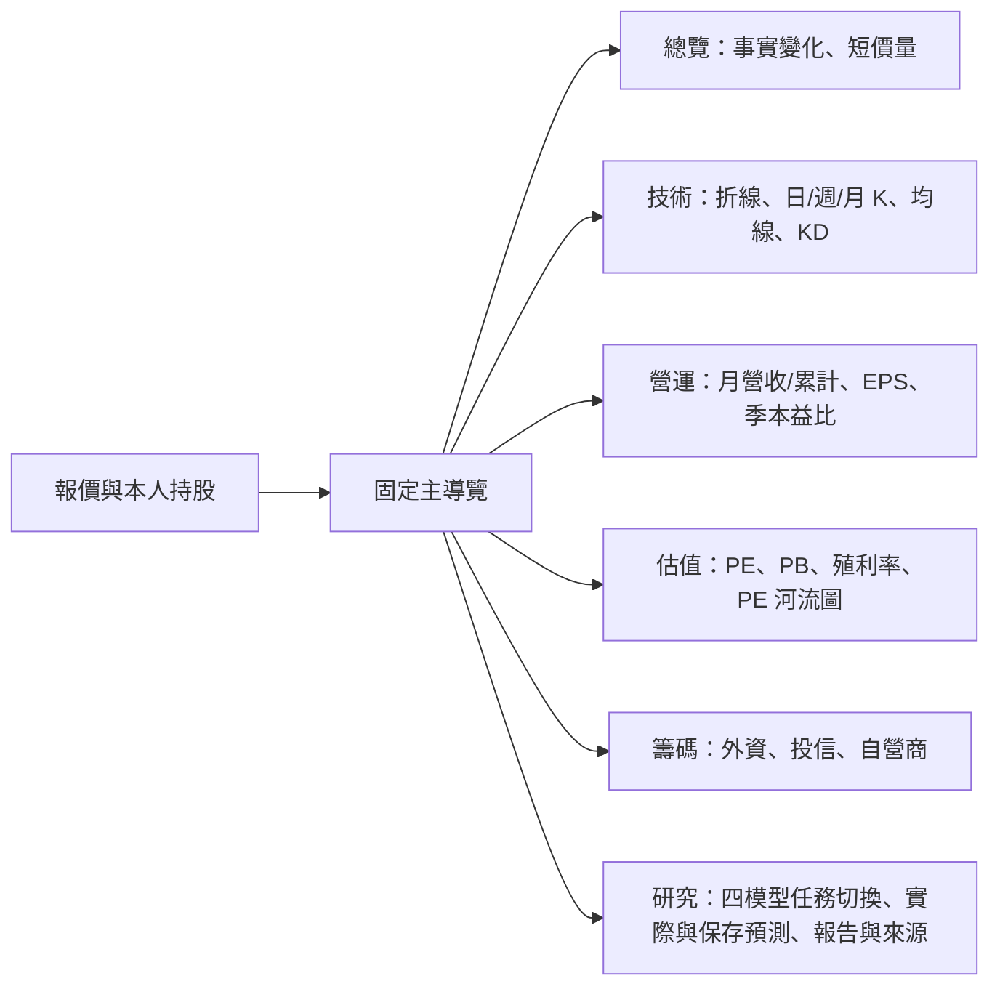

# 個股頁圖資 v2：參考畫面盤點、做法與預計 UI（2026-10-28）

> 狀態：**規劃＋部分實作（partial）**。本文件依使用者提供之參考 App 截圖（國巨 2327）盤點，區分「現有資料可做」與「缺資料」。
> 參考截圖僅作版面參考，Janus 自有評分不保證與參考 App 數值一致。資料一律標註來源；缺值顯示「—」或「資料不足」，不補值、不推算。

## 0. 整頁重構決策（2026-10-28，使用者覆蓋）

本次改為**整個個股頁的資訊架構重構**，取代在舊長頁持續疊加元件。沿用報價、Owner 持股、既有 API／授權與設計色彩，固定單一主導覽：總覽／技術／營運／估值／籌碼／研究。每區只顯示本區控制項；總覽保留短價量與已保存事實變化，不重複四個單點模型數字；模型只在研究區按需讀取。非普通股只保留適用的總覽、技術、研究來源，不顯公司財務與法人功能。舊五面向健康度、重複摘要移除。

**公告與筆記先從個股頁移除，並停止這個頁面的讀取請求。** 不刪既有筆記資料、不變更其他頁面的筆記功能。此決策覆蓋 user-app、stock-detail-readable 與參考圖中對個股頁公告／筆記的相反呈現要求。

### 四模型研究呈現：任務、歷史、實際與預測

研究區以四個中文任務切換，預設波動風險；一次只看一個角色的歷史比較（Valuation 分 PE／PB 兩圖），不再堆五張長卡或只放單一時間點數字；版本、來源、原始報告與 CEO 手動能力置於其後，技術細節收合。不得開頁自動呼叫模型／LLM。沿現有 `private.specialist_product` 不可變保存結果，新增 authenticated `GET /api/v1/me/analysis/{symbol}/model-timeline`，依 token Owner 的持股／關注 membership 篩選存取，最多 80 個資料日，每日取最後一個保存版本；不接受 client 選 Owner。

| 角色 | 真正模型任務 | 使用者看到的比較 |
|---|---|---|
| Quant15 | `p_up_20d`：未來 20 個市場交易日上漲機率，非打敗大盤機率 | 依期間結束日比較保存機率與真實上漲／未上漲結果（100／0），並列實際區間報酬；單次結果不是實際機率或準確率 |
| Risk12 | `future_rms_vol20`：未來 20 個交易日年化 log-return RMS 波動 | 實際滾動 20 日波動藍線與保存預測橘色虛線，按同一期間結束日對齊；最新未到期預測保留並與近期實際波動白話比較，不說 36% 等於未來漲跌 36% |
| Fundamental15 | `next_month_revenue_yoy_pct`：下月營收年增率 | 按營收月份比較保存預測與真實同月年增率；缺去年同月不算，不假稱 EPS 預測 |
| Valuation PE／PB | 模型原生 `log_pe`／`log_pb` | 還原為倍數後分圖比較模型估值與當日市場 PE／PB；不是未來股價目標或保證報酬，唯一估值參考價帶仍沿既有契約 |

實際資料只讀有界 Serving：300 根日 K、營收／PE／PB 各最多 200 點，不掃 Core、不觸發補收、不建立新排程、模型訓練或資料表。Risk／Quant 使用既有市場交易日規則，21 個連續市場日價格才能產生 20 日結果，不能把第 20 筆非空價格當成第 20 個市場日。現有已驗證休市表只涵蓋 2026；不支援年份明示缺口，不猜未來休市日。行情保留原始未還原口徑，公司行動可能影響比較，需揭露。

缺模型時仍顯示已存在的實際走勢；歷史預測不足、來源不足、尚未公布／未滿 20 日分開顯示。不以最新模型回填歷史。原始輸入日與保存日並列，價量結果若晚於下一市場日開盤才保存、營收結果若晚於目標月份才保存，明示事後重算，不能宣稱當時已發布或前瞻驗證；估值保留當期估計語意；不同模型版本不接續畫成同一條預測線。原始碼／本機測試完成不代表已有 20 天真實預測或 Dev 上線成功。

本次本機驗證：Python 37 passed（1 個既有 multipart deprecation warning）；Flutter 全套 136 passed，最終導覽／模型分區調整後相關 40 passed；Dart 靜態分析無 error／warning，既有 style infos 保留。測試資料手機預覽不是 Dev／Owner 真實驗收，CI／Release／部署與歷史實際覆蓋仍待完成。

## 1. 盤點總表

| # | 區塊（參考畫面） | 可行性 | 資料來源（現有） | 缺口 / 備註 |
|---|---|---|---|---|
| 1 | 報價列：價、漲跌、總量、量增/量縮 % | ✅ 可做 | stock-header、`ohlcv` | 量縮% = 今日量 ÷ 前 5 日均量 − 1 |
| 2 | 標籤：上市/上櫃、產業、可當沖 | ✅ 可做 | `stock_master`、`day_trading_suspension` | 有股期／有權證：缺（期交所/權證清單未收） |
| 3 | 日 / 週 / 月 K＋MA5/20/60/240＋成交量＋KD(9) | ✅ 已實作後端、前端元件 | `ohlcv` → `GET /public/stocks/{s}/price-series?period=day\|week\|month` | Tier 2 標的 Serving 僅保留 ~120 日 → 240MA、週/月 K 期數不足時顯示「資料不足」 |
| 4 | 技術1/技術2（MACD、RSI 等） | ✅ 可做 | 同上，前端計算 | 待排 |
| 5 | 月營收：單月柱＋股價線、MoM、YoY、累計 YoY | ✅ 前端元件已寫 | `visual-series?metric=revenue`＋月 K 收盤 | Serving 營收僅留 **24 個月** → 只能顯示 2 年；參考畫面 2022 起需放寬 retention |
| 6 | 累計月營收＋累計 YoY | ✅ 前端元件已寫 | 同上 | 年中缺月則累計顯示「—」 |
| 7 | 「本月營收創新高」橫幅 | ⚠️ 部分 | 同上 | 只能宣稱「近 24 個月新高」，不得寫「歷史新高」 |
| 8 | 年度走勢（年營收） | ❌ 缺資料 | — | 需 ≥ 3 年營收（放寬 retention 或讀 Core） |
| 9 | EPS 柱＋股價線、季本益比 | ✅ 前端元件已寫 | `visual-series?metric=eps`（12 季）＋季底收盤 | 本益比 = 季底收盤 ÷ 近四季 EPS；缺季不算 |
| 10 | 同業本益比 | ⚠️ 可做（需新聚合） | `valuation` 全市場 × `stock_master` 產業 | 以同產業 PE 中位數，需批次產出 publication |
| 11 | 收益比、本業佔比 | ⚠️ 部分 | FinMind `TaiwanStockFinancialStatements` | 需營業利益、稅前淨利欄位入 Core，尚未投影 |
| 12 | ROE / ROA（含近四季） | ❌ 缺資料 | — | 需資產負債表（股東權益、總資產），未收 |
| 13 | 基本概況：本益比、股價淨值比、殖利率 | ✅ 可做 | `valuation` | — |
| 14 | 預估本益比 | ❌ 缺資料 | — | 需法人預估 EPS（多為付費） |
| 15 | 基本資訊：股本、市值、掛牌年數、經營項目、個股焦點、細產業 | ❌ 缺資料（大多） | 產業分類 ✅ | 需 MOPS 公司基本資料 adapter（免費）；「個股焦點」「細產業」無官方來源 |
| 16 | 屬性雷達：長期存股 / 波段價值 / 短線價差 % | ⚠️ 可做（需定義） | `ohlcv`、`day_trading`、`valuation`、EPS | 見 §3，自有規則；百分位以全市場橫斷面計算 |
| 17 | 短線特徵表：20 日均當沖量、20 日均量、5 日漲幅、日振幅 | ✅ 可做 | `ohlcv`、`day_trading`（`day_trade_shares`） | — |
| 18 | 多空因素健診（符合 N 項） | ⚠️ 可做（需規則表） | 法人、融資券、借券、當沖、營收、估值 | 需規則清單版本化 |
| 19 | 法人買賣超 | ✅ 已有 | `institutional` | — |
| 20 | 大戶持股 %、偷偷賣股、籌碼分佈 | ❌ 缺資料 | — | TDCC 股權分散表（`tdcc` 已核准 fallback，**無 adapter**） |
| 21 | 主力買賣超 / 分點 / 主力熱門買超 | ❌ 缺資料 | — | 分點資料無免費穩定來源；啟用付費需授權 |
| 22 | 概念股（BBU、超級電容…） | ❌ 缺資料 | — | 需第三方（Yahoo 等）或自建分類 |
| 23 | 法說會 N 天後 | ❌ 缺資料 | — | MOPS 法說會公告 adapter（免費） |
| 24 | 法人目標價 | ❌ 缺資料 | — | 付費／第三方 |
| 25 | 除權息 | ⚠️ 部分 | `twse-events` | 需確認除權息欄位完整度 |
| 26 | 資券 | ✅ 已有 | `financing`、`securities_lending_short` | 前端尚未成圖 |
| 27 | 綜合評語（AI） | ⚠️ 可做 | specialist／四模型 | LLM 不決定數值 |

## 2. 做法

### 2.1 價格序列 API（已實作）
- `GET /api/v1/public/stocks/{symbol}/price-series?period=day|week|month&limit=2..300`
- 只讀 Serving `ohlcv`（最多 1500 筆日線），記憶體聚合：週＝週一起算、月＝當月 1 日起算；O＝首日開、H/L＝極值、C＝末日收、量＝加總（任一日缺量則該根量為 null）。
- `ma5/ma20/ma60/ma240` 以聚合後收盤計算，期數不足為 `null`。`adjusted=false`（未還原除權息）。
- 實作：`packages/web_api/core.py::CoreQueryService.price_series`；路由 `services/api/app.py`；測試 `tests/test_price_series.py`。

### 2.2 前端元件（已接入重構後技術／營運區；Dev 待驗）
`apps/user_app/lib/final_stock_fundamentals.dart`
- `FvPeriodKChart`：K 線＋4 條均線＋量＋KD(9)；頂部 OHLC 與漲跌、均線數值列。
- `FvRevenueChart`：單月／累計切換；柱＝營收（億元）、線＝月底收盤；表格：月、今年、去年、YoY、MoM。
- `FvEpsChart`：單季 EPS 柱＋季底收盤線；表格：季度、EPS、近四季 EPS、本益比；腳註列出缺資料欄位。
- 月底收盤由 `price-series?period=month` 取得（`fvMonthlyCloseMap`）。

### 2.3 屬性評分（待做，自有規則 v1）
- 短線價差：20 日均當沖量、20 日均量、5 日漲幅、日振幅 → 各自全市場百分位，平均為分數。
- 波段價值：營收 YoY、EPS 年增、PE 相對產業、60 日動能。
- 長期存股：殖利率、EPS 穩定度（12 季標準差）、低波動、PB。
- 分數以批次產出 publication（每日 18:30 管線 A），API 只讀，不在請求時掃全市場。

## 3. 個股頁分區

- 配色沿用台股慣例：漲紅 `fvGain`、跌綠 `fvLoss`；均線 5 紫、20 橘、60 藍、240 粉紅。
- 每張圖下方標示來源、單位、是否還原、缺資料說明。
- 缺資料欄位不顯示假值；整欄缺時於腳註說明，不放空白欄。
